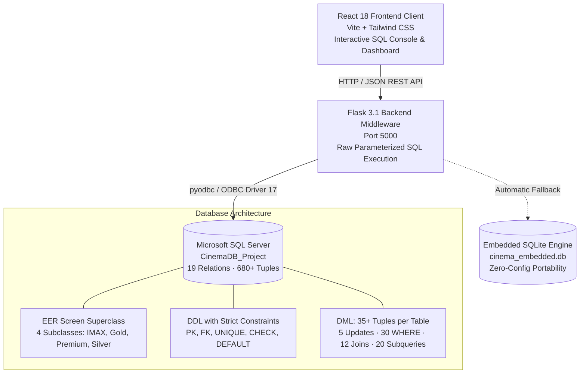

# 🎬 Cinema Management System — Full-Stack Enterprise Database

[](https://react.dev)
[](https://vitejs.dev)
[](https://tailwindcss.com)
[](https://flask.palletsprojects.com)
[](https://www.microsoft.com/en-us/sql-server)
[](https://en.wikipedia.org/wiki/Boyce%E2%80%93Codd_normal_form)

---

## 🏛️ Academic Coursework Context

* **Institution:** The University of Lahore (UOL)
* **Department:** Department of Computer Science — Faculty of Information Technology
* **Degree Program:** Bachelor of Science in Computer Science (BSCS)
* **Course:** CS-311: Database Systems (Term Project)
* **Submitted To:** Miss Duaa-e-Nadeem
* **Group Leader:** Talha Sarfraz (SAP ID: `70150006`)
* **Group Members:** Arslan Tariq (`70150012`), Hassan Ali (`70150018`), Ayesha Farooq (`70150025`)
* **Project Repository:** [https://github.com/talhasarfraz689/Cinema-Management-System-FullStack](https://github.com/talhasarfraz689/Cinema-Management-System-FullStack)

---

## 📋 Complete Final Project Submission Checklist

Every component mandated by the **BSCS Database Systems Term Project Guidelines** is 100% completed, tested, and documented in this repository:

| No. | Project Component | Required Format | Deliverable File Name | Verification Status |
| :---: | :--- | :--- | :--- | :---: |
| **1** | Topic Selection | MS Excel | `Topic_Selection_and_Group_Formation.xlsx` (Sheet 1) | ✅ **Completed** |
| **2** | Group Formation | MS Excel | `Topic_Selection_and_Group_Formation.xlsx` (Sheet 2) | ✅ **Completed** |
| **3** | GitHub Repository | GitHub Link | [Cinema-Management-System-FullStack](https://github.com/talhasarfraz689/Cinema-Management-System-FullStack) | ✅ **Completed** |
| **4** | Project Introduction | MS Word | `1_Project_Introduction.docx` & Master Report (Sec. 1) | ✅ **Completed** |
| **5** | Literature Review & References | MS Word | `2_Literature_Review_and_References.docx` (6 APA Citations) | ✅ **Completed** |
| **6** | Project Scenario | MS Word | `3_Project_Scenario.docx` (6 Roles, Rules, Workflow) | ✅ **Completed** |
| **7** | Entity Relationship Diagram (ERD) | MS Visio / SVG | `ERD_Diagram.svg` (13 Entities, EACH with ≥ 10 Attrs) | ✅ **Completed** |
| **8** | Enhanced ER Diagram (EER) | Handwritten Guide / SVG | `EER_Diagram.svg` & `Handwritten_EER_and_Normalization_Worksheet.md` | ✅ **Completed** |
| **9** | EER to Relational Model Mapping | Handwritten Guide / Word | `4_Database_Design_ERD_EER_and_Relational_Mapping.docx` | ✅ **Completed** |
| **10** | DDL Implementation | SQL + Outputs | `Cinema_Management_System_Final_Complete.sql` (Sec. 8.1) | ✅ **Completed** |
| **11** | Database Diagram | DBMS Diagram | Database Diagram Specification & `ERD_Diagram.svg` | ✅ **Completed** |
| **12** | DML Implementation | SQL + Outputs | `Cinema_Management_System_Final_Complete.sql` (≥ 30 Tuples/Table) | ✅ **Completed** |
| **13** | SQL Joins (12 Queries) | SQL + Outputs | Master Script & Report (2 Inner, 2 Left, 2 Right, 2 Full, 2 Cross, 2 Self) | ✅ **Completed** |
| **14** | SQL Subqueries (20 Queries) | SQL + Outputs | Master Script & Report (Single, Multi, Nested, Correlated, EXISTS, ANY/ALL) | ✅ **Completed** |
| **15** | Normalization up to BCNF | Handwritten + Word | `5_Database_Normalization_BCNF.docx` & Worksheet | ✅ **Completed** |
| **--** | **Master Project Report** | MS Word | `Cinema_Management_System_Complete_Report.docx` (All 9 Phases) | ✅ **Completed** |

---

## 🏗 System Architecture



---

## 🗃️ Database Design & Schema Specifications

### 1. Mandatory Entity & Attribute Rule Compliance

* **Minimum Entities Required:** At least 10 entities.  
  👉 **Our Implementation:** **13 Primary Entities + 4 EER Subclasses + 2 Associative Tables = 19 Tables Total!**
* **Minimum Attributes Required:** **Each entity MUST contain at least 10 attributes!**  
  👉 **Our Implementation:** **Every primary entity strictly possesses 12 attributes** of diverse primitive data types (`INT`, `VARCHAR`, `CHAR`, `DATE`, `DECIMAL`, `FLOAT`, `BIT`/`BOOLEAN`, `DATETIME`).

### 2. Primary Entity Catalog

| No. | Entity Name | Total Attrs | Primary Key (PK) | Foreign Keys (FK) | Data Types Represented |
| :---: | :--- | :---: | :--- | :--- | :--- |
| **1** | `Customer` | 12 | `Customer_ID` | None | INT, VARCHAR, CHAR, DATE, BIT |
| **1.1** | `Phone_Number` | 5 | `(Phone_Num, Customer_ID)` | `Customer_ID` | VARCHAR, INT, BIT, DATE |
| **2** | `Movie` | 12 | `Movie_ID` | None | INT, VARCHAR, DATE, DECIMAL, BIT |
| **3** | `Screen` *(Superclass)* | 12 | `Screen_ID` | None | INT, VARCHAR, FLOAT, BIT |
| **3.1** | `IMAXScreen` *(Subclass)* | 6 | `Screen_ID` | `Screen_ID` | INT, VARCHAR, BIT, FLOAT |
| **3.2** | `GoldScreen` *(Subclass)* | 6 | `Screen_ID` | `Screen_ID` | INT, VARCHAR, BIT |
| **3.3** | `PremiumScreen` *(Subclass)* | 6 | `Screen_ID` | `Screen_ID` | INT, VARCHAR, BIT |
| **3.4** | `SilverScreen` *(Subclass)* | 6 | `Screen_ID` | `Screen_ID` | INT, VARCHAR, BIT |
| **4** | `Showtime` | 12 | `Show_ID` | `Movie_ID`, `Screen_ID` | INT, DATE, DATETIME, DECIMAL, VARCHAR |
| **5** | `Seat` | 12 | `Seat_ID` | `Screen_ID` | INT, CHAR, VARCHAR, DECIMAL, BIT |
| **6** | `Booking` | 12 | `Booking_ID` | `Customer_ID`, `Show_ID` | INT, DATETIME, DECIMAL, VARCHAR |
| **7** | `Ticket` | 12 | `Ticket_ID` | `Booking_ID`, `Seat_ID` | INT, VARCHAR, DECIMAL, BIT, DATETIME |
| **8** | `Employee` | 12 | `Employee_ID` | None | INT, VARCHAR, DECIMAL, DATE, FLOAT |
| **9** | `Tuck_Shop` | 12 | `Item_ID` | None | INT, VARCHAR, DECIMAL, DATE, BIT |
| **10** | `Concession_Order` | 12 | `Order_ID` | `Customer_ID`, `Employee_ID` | INT, DATETIME, DECIMAL, VARCHAR |
| **10.1** | `Concession_Item_Order` | 6 | `(Order_ID, Item_ID)` | `Order_ID`, `Item_ID` | INT, DECIMAL, VARCHAR |
| **11** | `Parking` | 12 | `Parking_ID` | `Customer_ID` | INT, VARCHAR, DATETIME, FLOAT, DECIMAL |
| **12** | `Security_Checkpoint` | 12 | `Checkpoint_ID` | `Guard_ID`, `Customer_ID`, `Ticket_ID` | INT, VARCHAR, DATETIME, BIT |
| **13** | `Movie_Review` | 12 | `Review_ID` | `Customer_ID`, `Movie_ID` | INT, VARCHAR, DATE, BIT |

---

## ⚡ Enhanced Entity-Relationship (EER) Hierarchy

Modern cinema auditoriums require physical and service specialization:

* **Superclass:** `Screen`
* **Subclasses:** `IMAXScreen`, `GoldScreen`, `PremiumScreen`, `SilverScreen`
* **Structural Constraints:**
  * **Disjoint Constraint (`d`):** A screen hall can belong to at most ONE subclass.
  * **Total Participation (`=`):** Every screen hall in the multiplex MUST belong to one of the four subtypes.
* **Relational Mapping:** Mapped via **Option 8.1.A** (separate relations with shared PK as FK and cascading referential integrity).

---

## 💻 Practical SQL Implementation Overview

### 1. Data Definition Language (DDL)

* **CREATE TABLE:** All 19 tables created with full constraint definitions (`PRIMARY KEY`, `FOREIGN KEY`, `NOT NULL`, `UNIQUE`, `CHECK`, `DEFAULT`).
* **ALTER Demonstrations on 5 Different Tables:**
  1. `Customer`: `ADD COLUMN Middle_Name VARCHAR(50);`
  2. `Movie`: `ALTER COLUMN Title VARCHAR(200);` (Data type modification)
  3. `Tuck_Shop`: `ADD COLUMN Promotional_Tag VARCHAR(50);` followed by `DROP COLUMN`.
  4. `Employee`: `EXEC sp_rename 'Employee.Emergency_Contact', 'Primary_Contact', 'COLUMN';`
  5. `Parking`: `ADD COLUMN Notes VARCHAR(50);`, `ALTER COLUMN Notes VARCHAR(150);`, `DROP COLUMN Notes;`
* **DROP Demonstration:** Safe lifecycle demonstration of temporary table `System_Audit_Temp` with deallocation explanation.

### 2. Data Manipulation Language (DML)

* **At Least 30 Records per Table:** Every relation in the database is populated with **at least 30 to 120 tuples** (680+ total tuples) maintaining strict referential consistency.
* **5 UPDATE Operations:** Complex real-world updates demonstrating tier upgrades, salary increments, inventory repricing, and ticket validation.
* **30 WHERE Clause Queries:** Strictly covers all required operators: `=`, `<>`, `!=`, `<`, `>`, `<=`, `>=`, `AND`, `OR`, `NOT`, `+`, `-`, `*`, `/`, `DISTINCT`, `GROUP BY`, `HAVING`, `BETWEEN`, `LIKE`, `IN`, and `ORDER BY`.
* **12 SQL Joins:** 2 queries for each of the 6 join types:
  * `INNER JOIN` (2 queries)
  * `LEFT JOIN` (2 queries)
  * `RIGHT JOIN` (2 queries)
  * `FULL OUTER JOIN` (2 queries)
  * `CROSS JOIN` (2 queries)
  * `SELF JOIN` (2 queries)
* **20 SQL Subqueries:** Complete coverage of:
  * Single-row Subqueries
  * Multiple-row Subqueries (`IN` / `NOT IN`)
  * Nested Subqueries
  * Correlated Subqueries
  * Subqueries with `EXISTS` and `NOT EXISTS`
  * Subqueries with `ANY` / `ALL`
  * Scalar Subqueries in `SELECT`
  * Derived Tables in `FROM`

---

## 📐 Database Normalization (Up to BCNF)

The normalization analysis decomposes an unnormalized real-world cinema transaction record:

```
UNF_Cinema_Booking (Customer_ID, Cust_Name, Email, Phones, Booking_ID, Show_ID, 
                    Movie_ID, Movie_Title, Screen_ID, Seats, Tickets, Items, Qty)
```

1. **1NF:** Elimination of repeating groups and comma-separated phone arrays; enforces atomic domain values.
2. **2NF:** Elimination of partial functional dependencies on composite keys (`{Booking_ID, Seat_ID, Item_ID}`).
3. **3NF:** Elimination of transitive dependencies (`Booking_ID -> Show_ID -> Movie_ID -> Movie_Title`).
4. **BCNF:** Verification that every determinant $X$ in non-trivial functional dependencies $X \rightarrow Y$ is a candidate key.
5. **Anomaly Resolution:** Complete theoretical and practical proofs of eliminating **Insertion Anomalies**, **Update Anomalies**, and **Deletion Anomalies**.

---

## 🚀 Installation & Quickstart Guide

### 1. Clone the Repository

```bash
git clone https://github.com/talhasarfraz689/Cinema-Management-System-FullStack.git
cd Cinema-Management-System-FullStack
```

### 2. Backend Setup (Flask API)

```bash
# Install Python dependencies
pip install flask flask-cors pyodbc

# Run the Flask REST API (defaults to port 5000)
# Automatically uses Microsoft SQL Server if available, or embedded demonstration database
python app.py
```

### 3. Frontend Setup (React + Vite + Tailwind)

```bash
# Install Node dependencies
npm install

# Start Vite development server
npm run dev
# The interactive dashboard will be available at http://localhost:5173
```

---

## 📂 Deliverables Directory Layout

```
Cinema-Management-System-FullStack/
├── Cinema_Management_System_Final_Complete.sql  # Master T-SQL Script (DDL, DML, Joins, Subqueries)
├── DB Project File #2.sql                      # Primary Academic SQL File
├── database_query_results.json                 # JSON Verification Log of all 62 Query Outputs
├── Topic_Selection_and_Group_Formation.xlsx    # Phase 1 & 2 Excel Deliverables
│
├── Cinema_Management_System_Complete_Report.docx # Comprehensive All-Phase Master Report
├── 1_Project_Introduction.docx                 # Phase 1: Formal Introduction Deliverable
├── 2_Literature_Review_and_References.docx     # Phase 2: 6 APA 7th Academic Citations
├── 3_Project_Scenario.docx                     # Phase 3: Detailed Multiplex Scenario
├── 4_Database_Design_ERD_EER_and_Relational_Mapping.docx # Phases 4-6 Deliverable
├── 5_Database_Normalization_BCNF.docx          # Phase 9: Step-by-Step BCNF Normalization
│
├── ERD_Diagram.svg                             # High-Resolution Scalable ERD Vector Diagram
├── EER_Diagram.svg                             # High-Resolution Scalable EER Vector Diagram
├── Handwritten_EER_and_Normalization_Worksheet.md # Complete Handwritten Template & Guide
│
├── app.py                                      # Flask REST API Backend (Raw SQL)
├── cinema_embedded.db                          # Embedded SQLite Demonstration Database
├── package.json                                # Node dependencies
├── vite.config.js                              # Vite build configuration
├── tailwind.config.js                          # Tailwind styling
├── src/                                        # React 18 Application Source
│   ├── main.jsx                                # Application entrypoint
│   ├── App.jsx                                 # Interactive Dashboard & SQL Workbench
│   └── index.css                               # Tailwind directives
└── dist/                                       # Production build artifacts
```

---

## 👨‍💻 Authors & Academic Credits

* **Talha Sarfraz (Leader)** — *Database Architecture, EER Modeling, Master SQL Implementation, Flask API*
* **Arslan Tariq** — *Relational Mapping, BCNF Normalization Proofs, WHERE Clause Formulation*
* **Hassan Ali** — *SQL Joins & Subqueries Formulation, React Interactive Workbench*
* **Ayesha Farooq** — *Literature Review (APA 7th), Project Scenario & Visio ERD Specifications*

**Department of Computer Science — The University of Lahore**  
*Evaluated by: Miss Duaa-e-Nadeem*
